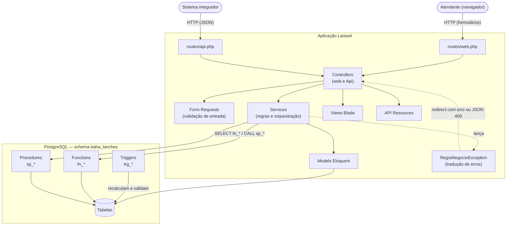
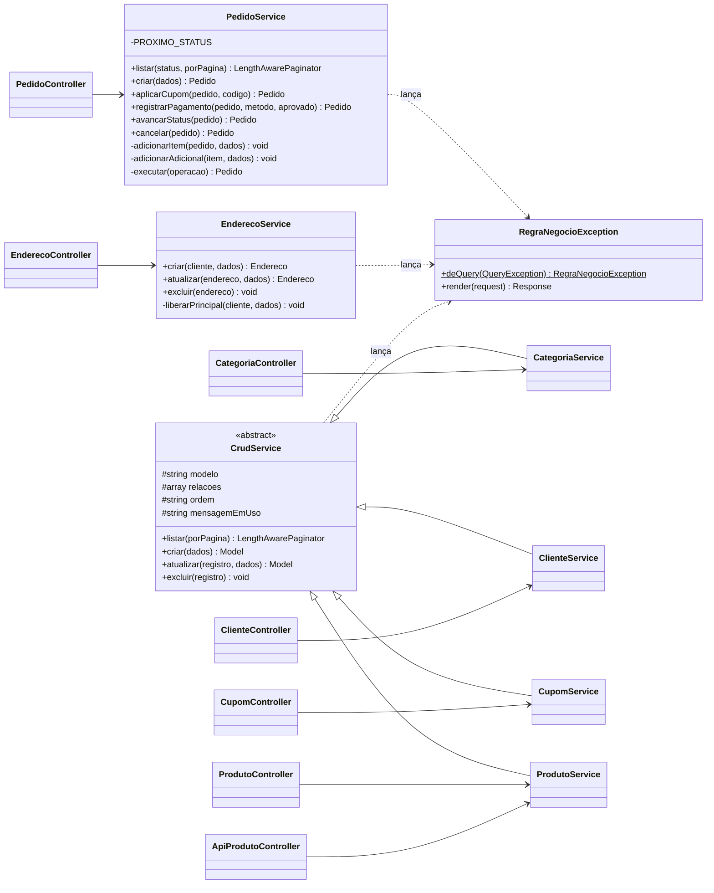
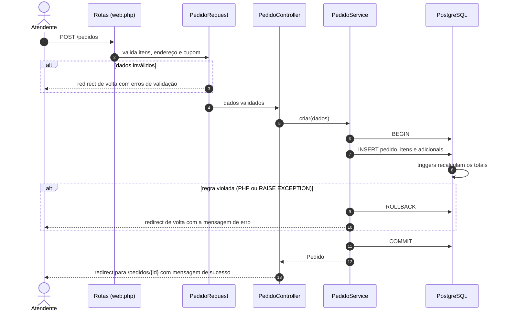

# 2. Arquitetura

## 2.1 Visão geral

O Baha Lanches é um **monólito Laravel em camadas**. A mesma aplicação atende duas interfaces:

- **Web (Blade):** telas renderizadas no servidor, usadas pelo atendente.
- **API REST (JSON):** expõe o cadastro de produtos para sistemas externos.

As regras que dependem de consistência dos dados (cálculo de totais, desconto de cupom, cancelamento, bloqueio de pedidos encerrados) ficam **no PostgreSQL**, em functions, procedures e triggers. O PHP orquestra o fluxo, valida a entrada e traduz os erros do banco em mensagens para o usuário. O motivo dessa escolha está em [ADR-0001](adr/0001-regras-criticas-no-banco.md).

## 2.2 Diagrama de componentes



## 2.3 Camadas e responsabilidades

| Camada | Local | Responsabilidade | Não deve |
|---|---|---|---|
| Rotas | `routes/web.php`, `routes/api.php` | Mapear URLs para controllers. Usam `Route::resource` e `Route::apiResource`. | Conter lógica |
| Form Requests | `app/Http/Requests` | Validar formato e existência dos dados de entrada. O `PedidoRequest` também descarta linhas de item vazias do formulário. | Consultar regras que dependem do estado do pedido |
| Controllers | `app/Http/Controllers` | Receber a requisição já validada, chamar o service e escolher a resposta (view, redirect ou resource). | Acessar o banco diretamente ou calcular valores |
| Services | `app/Services` | Implementar os casos de uso: abrir transações, aplicar regras, chamar functions e procedures, traduzir erros. | Montar HTML ou JSON |
| Models | `app/Models` | Mapear tabelas, relacionamentos e conversões de tipo (`casts`). | Conter regras de negócio |
| Views | `resources/views` | Exibir dados e formulários. Exibem ações conforme o status do pedido. | Decidir regras (a view só esconde botões; a regra é garantida no service e no banco) |
| API Resources | `app/Http/Resources` | Definir o formato do JSON público. | Expor colunas internas sem necessidade |
| Banco | `database/sql/02_objetos.sql` | Calcular totais e descontos, impedir estados inválidos, garantir unicidade. | — |

## 2.4 Diagrama de classes



> `ApiProdutoController` representa `App\Http\Controllers\Api\ProdutoController`.

### Por que existe o `CrudService`

Categorias, clientes, cupons e produtos têm o mesmo comportamento de cadastro: listar paginado, criar, atualizar e excluir. A classe abstrata `CrudService` concentra isso. Cada filho só declara o model, a ordenação e a mensagem exibida quando a exclusão é bloqueada por chave estrangeira (código `23503` do PostgreSQL). Endereços e pedidos têm regras próprias e por isso usam services independentes.

## 2.5 Estrutura de pastas

```text
baha-lanches/
├── app/
│   ├── Exceptions/RegraNegocioException.php   # tradução de erros do banco
│   ├── Http/
│   │   ├── Controllers/                       # controllers web
│   │   │   └── Api/ProdutoController.php      # controller da API
│   │   ├── Requests/                          # validação (Form Requests)
│   │   └── Resources/ProdutoResource.php      # formato do JSON
│   ├── Models/                                # 13 models Eloquent
│   ├── Providers/AppServiceProvider.php       # paginação Bootstrap e precisão de timestamps
│   └── Services/                              # casos de uso
├── bootstrap/app.php                          # rotas, middleware e renderização JSON da API
├── config/database.php                        # conexão pgsql com search_path = DB_SCHEMA
├── database/
│   ├── migrations/                            # estrutura das tabelas + carga do 02_objetos.sql
│   ├── seeders/DatabaseSeeder.php             # executa o 03_dados.sql
│   ├── sql/                                   # scripts SQL (ver Operação do banco)
│   └── backups/                               # dump gerado pelo pg_dump
├── docs/                                      # esta documentação
├── public/css/app.css                         # estilo próprio sobre o Bootstrap
├── resources/views/                           # telas Blade, uma pasta por módulo
├── routes/                                    # web.php e api.php
└── tests/                                     # Unit, Feature e helpers (Concerns)
```

## 2.6 Ciclo de uma requisição

O exemplo abaixo mostra a criação de um pedido pela tela. O fluxo é o mesmo para as demais ações.



## 2.7 Tratamento de erros

Existem três tipos de erro, cada um com um tratamento:

| Tipo | Origem | Como chega ao usuário |
|---|---|---|
| Validação | Form Request | Web: volta ao formulário com a lista de erros. API: HTTP `422` com o campo `errors`. |
| Regra de negócio | `throw new RegraNegocioException(...)` no service, ou `RAISE EXCEPTION` no banco (SQLSTATE `P0001`) | Web: volta à página anterior com a mensagem na sessão (`erro`). API: HTTP `409` com `{"message": "..."}`. |
| Registro em uso | Exclusão bloqueada por chave estrangeira (SQLSTATE `23503`) | Convertido em `RegraNegocioException` com mensagem própria de cada cadastro. |

A conversão dos erros do banco é centralizada:

- `PedidoService::executar()` roda a operação em transação e converte `QueryException` com código `P0001` em `RegraNegocioException`.
- `RegraNegocioException::deQuery()` extrai só a primeira linha da mensagem do PostgreSQL (remove o prefixo `ERROR:` e o `CONTEXT`).
- `RegraNegocioException::render()` decide o formato da resposta: JSON para `api/*` ou requisições que esperam JSON; redirect com mensagem para a web.

## 2.8 Transações e concorrência

- **Criar pedido, aplicar cupom, cancelar e registrar pagamento** rodam dentro de `DB::transaction`. Se qualquer item falhar, nada é gravado.
- **Registrar pagamento** usa `lockForUpdate()` para impedir que duas requisições simultâneas registrem dois pagamentos. A restrição `pagamentos_pedido_id_unique` garante isso também no banco.
- **Procedures e trigger de totais** usam `SELECT ... FOR UPDATE` no pedido, serializando alterações concorrentes no mesmo pedido.
- **Cadastro de endereço principal** desmarca o principal anterior na mesma transação, respeitando o índice único parcial `uq_enderecos_cliente_principal`.

## 2.9 Configurações relevantes

| Item | Onde | Efeito |
|---|---|---|
| `DB_SCHEMA` | `.env` → `config/database.php` (`search_path`) | Todas as consultas rodam no schema `baha_lanches`. |
| `DB_SSLMODE` | `.env` | `require` no Neon; `disable` ou `prefer` em banco local. |
| `Builder::defaultTimePrecision(null)` | `AppServiceProvider` | Mantém frações de segundo nos timestamps, como no banco original. |
| `Paginator::useBootstrapFive()` | `AppServiceProvider` | Links de paginação no estilo Bootstrap 5. Listagens usam 15 registros por página. |
| `shouldRenderJsonWhen` | `bootstrap/app.php` | Toda exceção em `api/*` é devolvida em JSON. |
| `APP_LOCALE=pt_BR` | `.env` | Idioma padrão da aplicação. |
