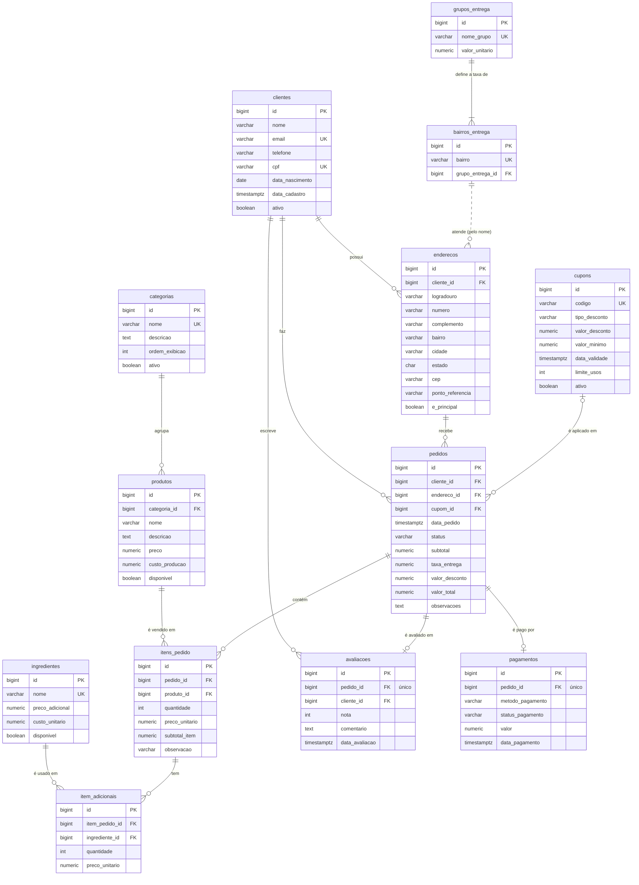

# 3. Modelo de dados

Todas as tabelas ficam no schema `baha_lanches` do PostgreSQL. A estrutura é criada pelas migrations em `database/migrations` e está consolidada, em formato `pg_dump`, em `database/sql/00_estrutura.sql`.

## 3.1 Diagrama entidade-relacionamento



> Todas as tabelas também têm `created_at` e `updated_at` (`timestamptz`), omitidos do diagrama. A ligação entre `bairros_entrega` e `enderecos` é feita pelo **nome do bairro**, sem chave estrangeira: ela é garantida pela validação `exists:bairros_entrega,bairro` no cadastro de endereço.

## 3.2 Dicionário de dados

Valores monetários usam `numeric(10,2)`. Datas usam `timestamptz`.

### Cardápio

| Tabela | Finalidade | Observações |
|---|---|---|
| `categorias` | Seções do cardápio (lanches, bebidas…) | `nome` único; `ordem_exibicao` define a ordem nas telas. |
| `produtos` | Itens vendidos | `preco` e `custo_producao` ≥ 0. `disponivel = false` tira o produto do formulário de pedido sem apagar o histórico. |
| `ingredientes` | Adicionais cobrados à parte | `nome` único; `preco_adicional` e `custo_unitario` ≥ 0. |

### Clientes e entrega

| Tabela | Finalidade | Observações |
|---|---|---|
| `clientes` | Pessoas que fazem pedidos | `email` e `cpf` únicos; CPF no formato `000.000.000-00`. `ativo = false` impede novos pedidos. |
| `enderecos` | Endereços de entrega | Excluídos em cascata com o cliente. No máximo um `e_principal = true` por cliente (índice `uq_enderecos_cliente_principal`). `estado` padrão `PR`. |
| `grupos_entrega` | Faixas de distância | `valor_unitario` é a taxa de entrega do grupo. |
| `bairros_entrega` | Bairros atendidos | `bairro` único; cada bairro pertence a um grupo. |

### Pedidos

| Tabela | Finalidade | Observações |
|---|---|---|
| `pedidos` | Cabeçalho do pedido | `status` restrito a `RECEBIDO`, `EM_PREPARO`, `PRONTO`, `SAIU_PARA_ENTREGA`, `ENTREGUE`, `CANCELADO`. `subtotal`, `valor_desconto` e `valor_total` são mantidos pelo banco. `taxa_entrega` é gravada na criação e não muda depois. |
| `itens_pedido` | Produtos do pedido | `quantidade` > 0. `preco_unitario` guarda o preço do produto **no momento da venda**. Excluídos em cascata com o pedido. |
| `item_adicionais` | Adicionais de cada item | `quantidade` > 0 (padrão 1). `preco_unitario` guarda o `preco_adicional` no momento da venda. |
| `cupons` | Descontos | `codigo` único, sempre em maiúsculas. `tipo_desconto` é `PERCENTUAL` ou `VALOR_FIXO`; `valor_desconto` > 0; `valor_minimo` ≥ 0. |
| `pagamentos` | Pagamento do pedido | Um por pedido (`pagamentos_pedido_id_unique`). `metodo_pagamento`: `PIX`, `CARTAO_CREDITO`, `CARTAO_DEBITO`, `DINHEIRO`, `VALE_REFEICAO`. `status_pagamento`: `PENDENTE`, `APROVADO`, `RECUSADO`, `ESTORNADO`. `valor` > 0. |
| `avaliacoes` | Nota do cliente | Uma por pedido; `nota` de 1 a 5. |

## 3.3 Cálculo dos valores do pedido

```text
subtotal_item    = quantidade × preco_unitario                 (calculado no PHP)
subtotal         = Σ subtotal_item + Σ (adicional.quantidade × adicional.preco_unitario)
valor_desconto   = fn_calcular_desconto_cupom(cupom, subtotal)  (0 se não houver cupom)
valor_total      = subtotal + taxa_entrega − valor_desconto
```

`subtotal`, `valor_desconto` e `valor_total` são recalculados pelo trigger `trg_itens_recalcular_total` / `trg_adicionais_recalcular_total` a cada alteração de item ou adicional. O PHP nunca grava esses valores diretamente, exceto os valores iniciais na criação do pedido (subtotal 0 e total igual à taxa). Detalhes em [Objetos do banco](04-objetos-do-banco.md).

## 3.4 Integridade referencial

| Chave estrangeira | Ao excluir o pai |
|---|---|
| `enderecos.cliente_id` | `CASCADE` |
| `itens_pedido.pedido_id`, `item_adicionais.item_pedido_id` | `CASCADE` |
| `pagamentos.pedido_id`, `avaliacoes.pedido_id` | `CASCADE` |
| `produtos.categoria_id` | Bloqueia (`23503` → "Categoria com produtos não pode ser excluída") |
| `itens_pedido.produto_id` | Bloqueia (→ "Produto já vendido não pode ser excluído") |
| `pedidos.cliente_id` | Bloqueia (→ "Cliente com pedidos não pode ser excluído") |
| `pedidos.endereco_id` | Bloqueia (→ "Endereço já usado em pedidos não pode ser excluído") |
| `pedidos.cupom_id` | Bloqueia (→ "Cupom já usado em pedidos não pode ser excluído") |

A orientação para o usuário nesses casos é **desativar** o registro (`ativo = false` ou `disponivel = false`) em vez de excluir, preservando o histórico de vendas.

## 3.5 Índices

| Índice | Tabela | Tipo | Uso |
|---|---|---|---|
| `uq_enderecos_cliente_principal` | `enderecos (cliente_id) WHERE e_principal` | Único parcial | Garante um endereço principal por cliente |
| `idx_pedidos_abertos_data` | `pedidos (data_pedido) WHERE status em aberto` | Parcial | Painel de pedidos em andamento |
| `idx_gabriel_data_pedido_pedidos` | `pedidos (data_pedido)` | B-tree | Ordenação e filtro por data |
| `idx_gabriel_id_cliente_pedidos` | `pedidos (cliente_id)` | B-tree | Pedidos de um cliente |
| `idx_gabriel_id_pedido_itens_pedido` | `itens_pedido (pedido_id)` | B-tree | Itens de um pedido |

O ganho medido de cada índice está em [Operação do banco](09-operacao-do-banco.md#94-análise-de-desempenho-dos-índices).
