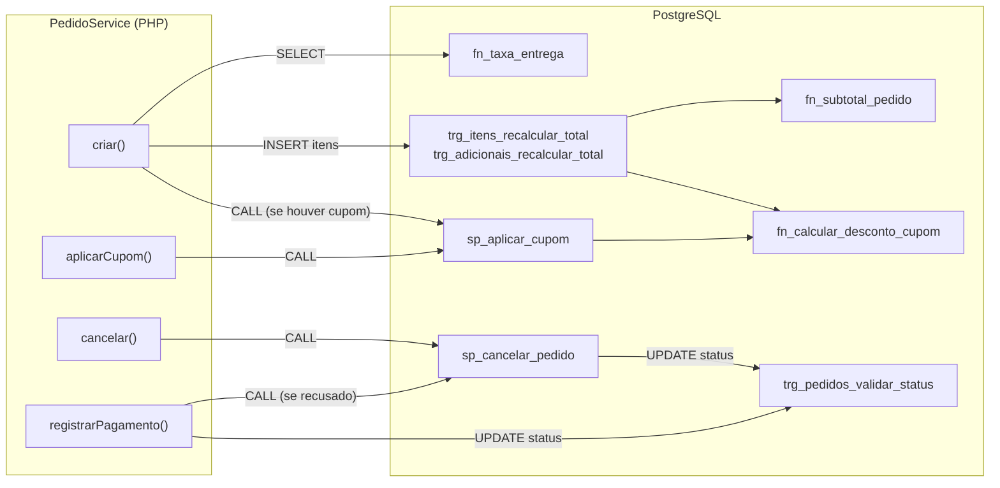
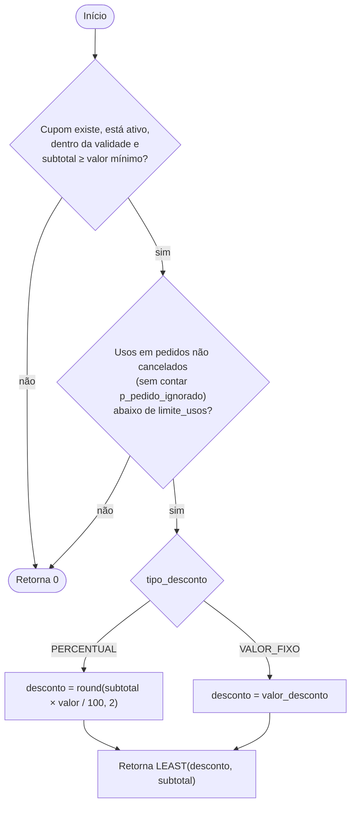
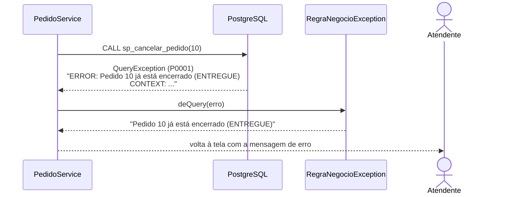

# 4. Objetos do banco

As functions, procedures, triggers e índices de regra de negócio estão em `database/sql/02_objetos.sql`. Esse arquivo é executado pelas migrations `2026_11_01_000012_create_objetos_banco` e `2026_11_02_000003_ajustar_regras_entrega_pagamento`, então `php artisan migrate` já deixa o banco completo. Todos os objetos usam `SET search_path FROM CURRENT` para funcionar mesmo quando chamados de outro schema.

## 4.1 Visão geral

## 4.2 Functions

### `fn_taxa_entrega(p_bairro varchar) → numeric`

Retorna a taxa de entrega do grupo ao qual o bairro pertence.

| Situação | Resultado |
|---|---|
| Bairro cadastrado em `bairros_entrega` | `grupos_entrega.valor_unitario` |
| Bairro não cadastrado | `RAISE EXCEPTION 'Não há entrega para o bairro %'` |

Chamada por `PedidoService::criar()`. A taxa é gravada em `pedidos.taxa_entrega`; mudar o valor do grupo depois não altera pedidos antigos.

### `fn_subtotal_pedido(p_pedido_id bigint) → numeric`

Soma `subtotal_item` de todos os itens e `quantidade × preco_unitario` de todos os adicionais do pedido. Retorna `0` para pedido sem itens. Usada pelo trigger de totais e pelo script de verificação `05_verificar_restauracao.sql`.

### `fn_calcular_desconto_cupom(p_cupom_id, p_subtotal, p_pedido_ignorado DEFAULT NULL) → numeric`

Calcula o desconto de um cupom sobre um subtotal. **Nunca lança erro**: quando o cupom não se aplica, retorna `0`.

O parâmetro `p_pedido_ignorado` existe para que, ao recalcular o desconto de um pedido que **já usa** o cupom, esse próprio pedido não conte contra o limite de usos.

## 4.3 Procedures

### `sp_aplicar_cupom(p_pedido_id bigint, p_codigo varchar)`

Aplica um cupom ao pedido e atualiza `cupom_id`, `valor_desconto` e `valor_total`. Bloqueia o pedido com `FOR UPDATE` e valida, nesta ordem:

| # | Validação | Mensagem quando falha |
|---|---|---|
| 1 | Pedido existe | `Pedido % não encontrado` |
| 2 | Pedido está aberto | `Pedido % já está encerrado (%)` |
| 3 | Pedido ainda não tem cupom | `Pedido % já possui cupom` |
| 4 | Pedido ainda não tem pagamento | `Pedido % já tem pagamento e não aceita cupom` |
| 5 | Cupom existe (código comparado com `upper()`) | `Cupom % não encontrado` |
| 6 | `fn_calcular_desconto_cupom` retorna valor > 0 | `Cupom % não pode ser aplicado a este pedido` |

### `sp_cancelar_pedido(p_pedido_id bigint)`

Cancela um pedido aberto e ajusta o pagamento, se houver:

| Pagamento antes | Pagamento depois |
|---|---|
| `APROVADO` | `ESTORNADO` |
| `PENDENTE` | `RECUSADO` |
| `RECUSADO` / sem pagamento | sem alteração |

Falha com `Pedido % não encontrado` ou `Pedido % já está encerrado (%)`.

## 4.4 Triggers

| Trigger | Tabela | Momento | Function |
|---|---|---|---|
| `trg_itens_recalcular_total` | `itens_pedido` | `AFTER INSERT OR UPDATE OR DELETE`, por linha | `fn_trg_recalcular_total_pedido` |
| `trg_adicionais_recalcular_total` | `item_adicionais` | `AFTER INSERT OR UPDATE OR DELETE`, por linha | `fn_trg_recalcular_total_pedido` |
| `trg_pedidos_validar_status` | `pedidos` | `BEFORE UPDATE OF status`, por linha | `fn_trg_validar_status_pedido` |

### `fn_trg_recalcular_total_pedido`

1. Descobre o pedido afetado (direto pelo item ou, no caso de adicional, pelo item ao qual ele pertence).
2. Se o pedido não existe mais (exclusão em cascata), não faz nada.
3. Bloqueia alterações em pedido **encerrado** ou **já pago**.
4. Recalcula `subtotal` com `fn_subtotal_pedido`.
5. Se o pedido tem cupom, recalcula o desconto com `fn_calcular_desconto_cupom`. Se o novo subtotal ficou abaixo do mínimo, o desconto cai para `0`.
6. Atualiza `valor_total = subtotal + taxa_entrega − valor_desconto`.

### `fn_trg_validar_status_pedido`

Impede que um pedido `ENTREGUE` ou `CANCELADO` mude para qualquer outro status: `Pedido % já está encerrado (%) e não pode mudar para %`. Funciona como última barreira, mesmo que o PHP tente atualizar o status por outro caminho.

## 4.5 Como os erros chegam à tela

Todo `RAISE EXCEPTION` sem código explícito gera o SQLSTATE `P0001`. O fluxo é:

Erros com outros códigos (ex.: violação de `CHECK`) não são convertidos e seguem como erro 500, porque indicam falha de programação, e não uma situação esperada do negócio.

## 4.6 Manutenção

- Ao alterar uma function, procedure ou trigger, edite `02_objetos.sql` e **crie uma nova migration** que execute o arquivo de novo (como faz `2026_11_02_000003`). Os objetos usam `CREATE OR REPLACE`, então reexecutar é seguro.
- Atualize também `00_estrutura.sql` (gerado com `pg_dump --schema-only`) para manter o script de estrutura consistente.
- Cubra a mudança em `tests/Feature/Banco`. Ver [Testes](10-testes.md).
