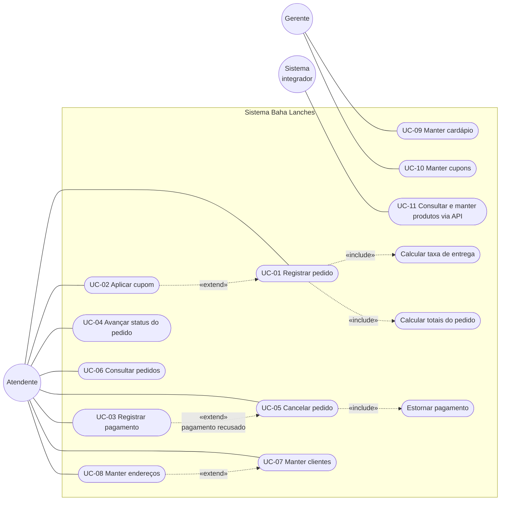

# 6. Casos de uso

## 6.1 Diagrama de casos de uso (UML)

O Mermaid não tem um tipo nativo para diagramas de casos de uso. O diagrama abaixo segue a notação UML: atores fora da fronteira do sistema, casos de uso como elipses, e os relacionamentos `«include»` (sempre executado) e `«extend»` (opcional) com setas tracejadas.

> O gerente também pode executar todos os casos do atendente. Hoje os dois usam as mesmas telas, sem controle de acesso ([ADR-0005](adr/0005-sem-autenticacao-na-versao-atual.md)).

## 6.2 Resumo

| Código | Caso de uso | Ator | Tela / endpoint |
|---|---|---|---|
| UC-01 | Registrar pedido | Atendente | `GET/POST /pedidos/create`, `/pedidos` |
| UC-02 | Aplicar cupom | Atendente | `POST /pedidos/{pedido}/cupom` |
| UC-03 | Registrar pagamento | Atendente | `POST /pedidos/{pedido}/pagamento` |
| UC-04 | Avançar status do pedido | Atendente | `POST /pedidos/{pedido}/avancar-status` |
| UC-05 | Cancelar pedido | Atendente | `POST /pedidos/{pedido}/cancelar` |
| UC-06 | Consultar pedidos | Atendente | `GET /pedidos`, `GET /pedidos/{pedido}` |
| UC-07 | Manter clientes | Atendente | `/clientes` |
| UC-08 | Manter endereços | Atendente | `/clientes/{cliente}/enderecos`, `/enderecos/{endereco}` |
| UC-09 | Manter cardápio | Gerente | `/categorias`, `/produtos` |
| UC-10 | Manter cupons | Gerente | `/cupons` |
| UC-11 | Consultar e manter produtos via API | Sistema integrador | `/api/produtos` |

## 6.3 Especificações

### UC-01 — Registrar pedido

| | |
|---|---|
| **Ator** | Atendente |
| **Objetivo** | Registrar o pedido de um cliente para entrega. |
| **Pré-condições** | Cliente ativo com ao menos um endereço em bairro atendido; produtos disponíveis no cardápio. |
| **Pós-condições** | Pedido gravado com status `RECEBIDO`, itens, adicionais, taxa de entrega e totais calculados. |
| **Regras** | RN-01 a RN-07, RN-18 a RN-22 |

**Fluxo principal**

1. O atendente abre **Pedidos → Novo pedido**.
2. O sistema lista os endereços de clientes ativos, os produtos disponíveis e os adicionais disponíveis.
3. O atendente escolhe o endereço de entrega.
4. O atendente adiciona um ou mais itens, informando produto, quantidade, observação e adicionais.
5. O atendente informa observações gerais e, opcionalmente, um código de cupom.
6. O atendente confirma.
7. O sistema valida os dados, calcula a taxa de entrega pelo bairro, grava o pedido e os itens e recalcula os totais.
8. O sistema exibe o detalhe do pedido com a mensagem "Pedido criado. Registre o pagamento."

**Fluxos alternativos**

| Ponto | Condição | Comportamento |
|---|---|---|
| 5 | Cupom informado | Executa UC-02 dentro da mesma transação. |
| 7 | Dados inválidos (sem itens, quantidade 0, endereço inexistente) | Volta ao formulário com os erros de validação. |
| 7 | Cliente inativo, produto ou adicional indisponível | Volta ao formulário com a mensagem; nada é gravado. |
| 7 | Cupom inválido ou que não se aplica | Volta ao formulário com a mensagem do banco; nada é gravado. |

### UC-02 — Aplicar cupom

| | |
|---|---|
| **Ator** | Atendente |
| **Objetivo** | Conceder desconto a um pedido. |
| **Pré-condições** | Pedido aberto, sem cupom e sem pagamento. Na tela, a ação aparece só para pedidos `RECEBIDO`. |
| **Pós-condições** | `cupom_id`, `valor_desconto` e `valor_total` atualizados. |
| **Regras** | RN-08, RN-18 a RN-23 |

**Fluxo principal**

1. No detalhe do pedido, o atendente digita o código do cupom e clica em **Aplicar cupom**.
2. O sistema executa `sp_aplicar_cupom`, que valida o pedido e o cupom e calcula o desconto.
3. O sistema exibe o pedido com o novo total e a mensagem "Cupom aplicado."

**Fluxos de exceção:** cupom inexistente, vencido, inativo, esgotado, abaixo do valor mínimo, pedido que já tem cupom ou já foi pago. Em todos os casos o pedido não muda e a mensagem do banco é exibida.

### UC-03 — Registrar pagamento

| | |
|---|---|
| **Ator** | Atendente |
| **Objetivo** | Registrar o resultado do pagamento do pedido. |
| **Pré-condições** | Pedido `RECEBIDO` e sem pagamento. |
| **Pós-condições** | Pagamento gravado. Aprovado → pedido `EM_PREPARO`. Recusado → pedido `CANCELADO`. |
| **Regras** | RN-12 a RN-17 |

**Fluxo principal**

1. No detalhe do pedido, o atendente escolhe o método de pagamento.
2. O atendente clica em **Pagamento aprovado**.
3. O sistema bloqueia o pedido, confirma que ele está aguardando pagamento e grava o pagamento `APROVADO` com o valor total.
4. O sistema muda o pedido para `EM_PREPARO`.

**Fluxos alternativos**

| Ponto | Condição | Comportamento |
|---|---|---|
| 2 | Atendente clica em **Pagamento recusado** | Grava o pagamento como `RECUSADO` e executa UC-05. |
| 3 | Pedido já tem pagamento ou não está `RECEBIDO` | Mensagem "Este pedido não está aguardando pagamento." |

### UC-04 — Avançar status do pedido

| | |
|---|---|
| **Ator** | Atendente |
| **Objetivo** | Acompanhar o preparo e a entrega. |
| **Pré-condições** | Pedido `EM_PREPARO`, `PRONTO` ou `SAIU_PARA_ENTREGA`. |
| **Pós-condições** | Pedido no próximo status da sequência. |
| **Regras** | RN-09, RN-10 |

**Fluxo principal:** o atendente clica em **Avançar status**; o sistema muda `EM_PREPARO → PRONTO → SAIU_PARA_ENTREGA → ENTREGUE`, um passo por clique.

**Fluxo de exceção:** pedido `RECEBIDO`, `ENTREGUE` ou `CANCELADO` → mensagem "O status X não pode avançar por esta ação."

### UC-05 — Cancelar pedido

| | |
|---|---|
| **Ator** | Atendente |
| **Objetivo** | Encerrar um pedido que não será entregue. |
| **Pré-condições** | Pedido aberto. |
| **Pós-condições** | Pedido `CANCELADO`; pagamento aprovado estornado; uso do cupom liberado. |
| **Regras** | RN-11, RN-16, RN-21 |

**Fluxo principal**

1. No detalhe do pedido, o atendente clica em **Cancelar pedido** e confirma.
2. O sistema executa `sp_cancelar_pedido`.
3. O sistema exibe o pedido cancelado com a mensagem "Pedido cancelado."

**Fluxo de exceção:** pedido já encerrado → mensagem "Pedido N já está encerrado (STATUS)".

### UC-06 — Consultar pedidos

O atendente vê a lista de pedidos, do mais recente para o mais antigo, paginada de 15 em 15, com filtro por status. Ao abrir um pedido, vê cliente, endereço, itens com adicionais, valores, cupom, pagamento, avaliação (se houver) e as ações permitidas para o status atual.

### UC-07 — Manter clientes

| | |
|---|---|
| **Ator** | Atendente |
| **Fluxos** | Listar, cadastrar, visualizar (com endereços e os 10 últimos pedidos), editar e excluir. |
| **Regras** | RN-24, RN-29, RN-30 |

Após cadastrar um cliente, o sistema abre o detalhe dele pedindo o cadastro de um endereço (UC-08). Cliente com pedidos não pode ser excluído; a orientação é desativá-lo.

### UC-08 — Manter endereços

| | |
|---|---|
| **Ator** | Atendente |
| **Fluxos** | Cadastrar, editar e excluir endereços de um cliente. |
| **Regras** | RN-25 a RN-28 |

O bairro é escolhido em uma lista com os bairros atendidos. Cidade e estado são preenchidos automaticamente. Endereço já usado em pedido só pode ter o campo "principal" alterado.

### UC-09 — Manter cardápio

| | |
|---|---|
| **Ator** | Gerente |
| **Fluxos** | CRUD de categorias (nome único, ordem de exibição, ativa) e de produtos (categoria, preço, custo, disponível). |
| **Regras** | RN-29 |

Produto já vendido não pode ser excluído; deve ser marcado como indisponível. Categoria com produtos não pode ser excluída; deve ser desativada.

### UC-10 — Manter cupons

| | |
|---|---|
| **Ator** | Gerente |
| **Fluxos** | CRUD de cupons: código, tipo, valor, valor mínimo, validade, limite de usos e situação. |
| **Regras** | RN-18, RN-19, RN-29 |

### UC-11 — Consultar e manter produtos via API

| | |
|---|---|
| **Ator** | Sistema integrador |
| **Fluxos** | Listar, consultar, criar, atualizar (total ou parcial) e excluir produtos em JSON. |
| **Regras** | Mesmas validações do UC-09; exclusão de produto vendido retorna `409`. |

Contrato completo em [API REST](08-api-rest.md).
