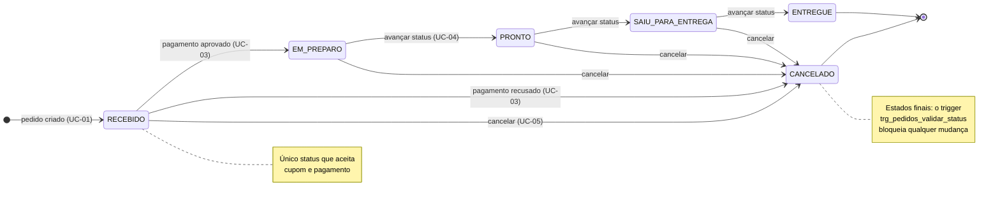
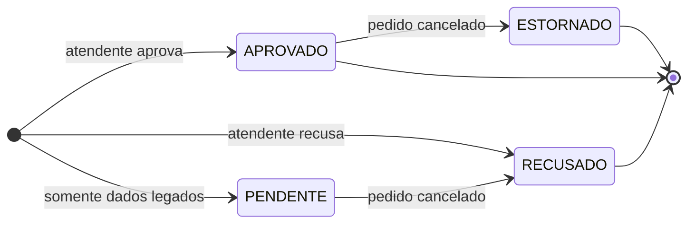
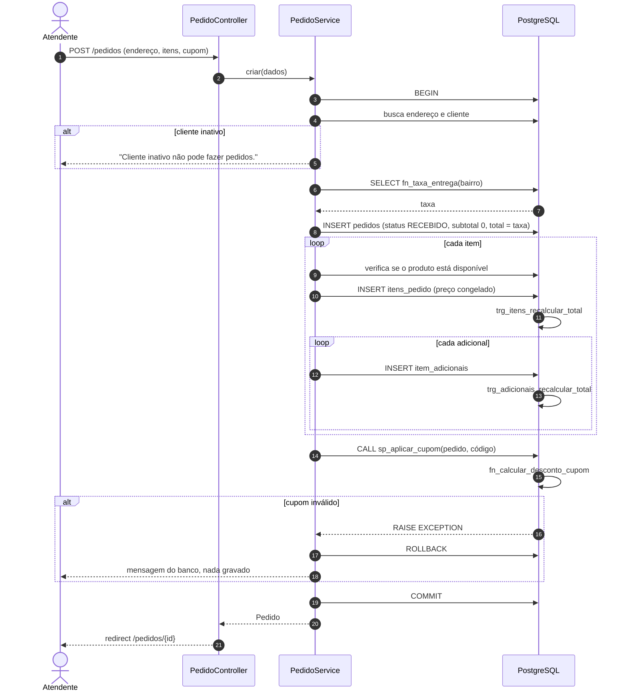
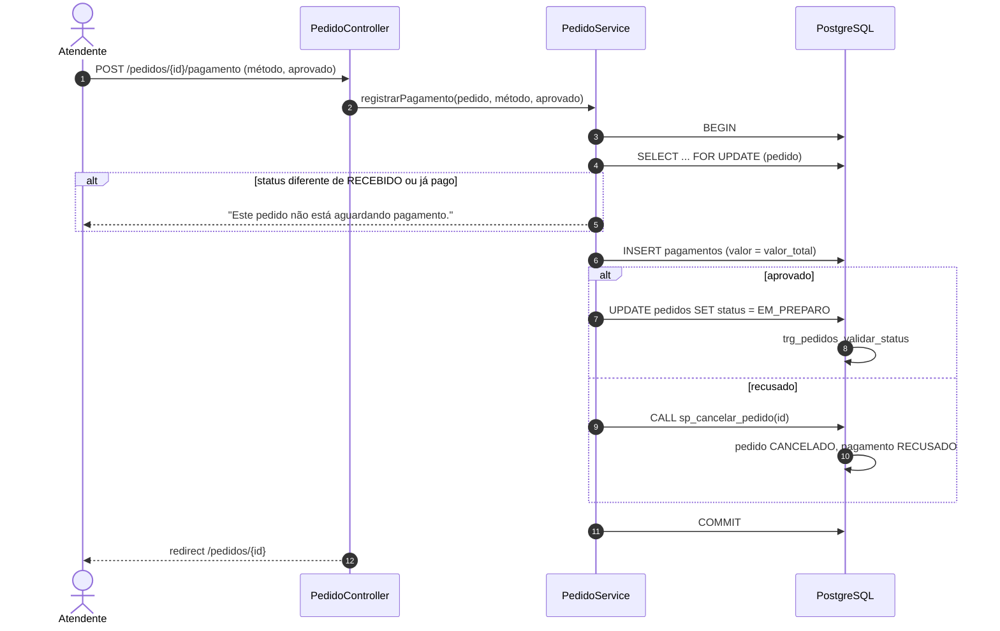
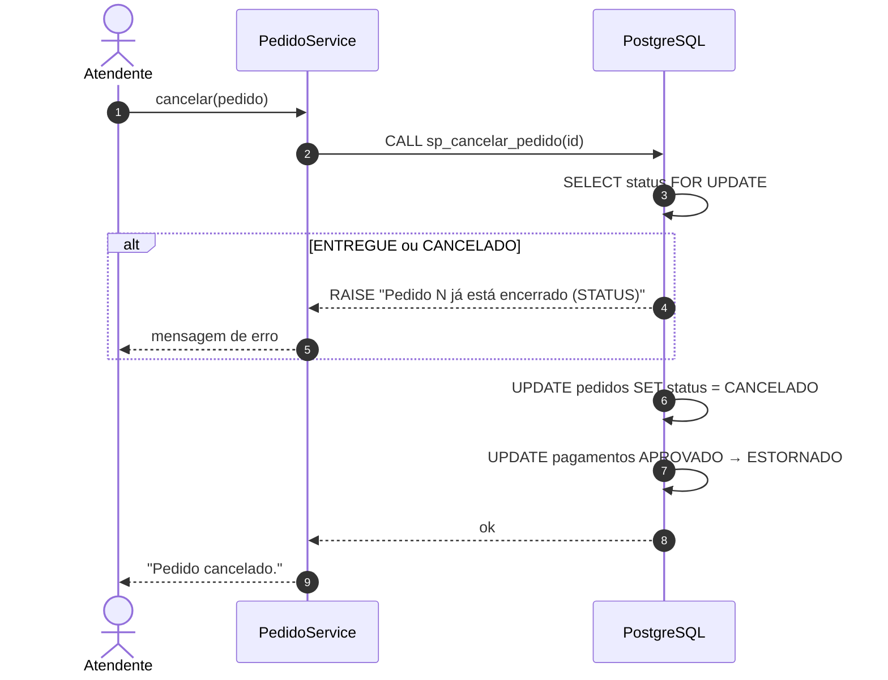
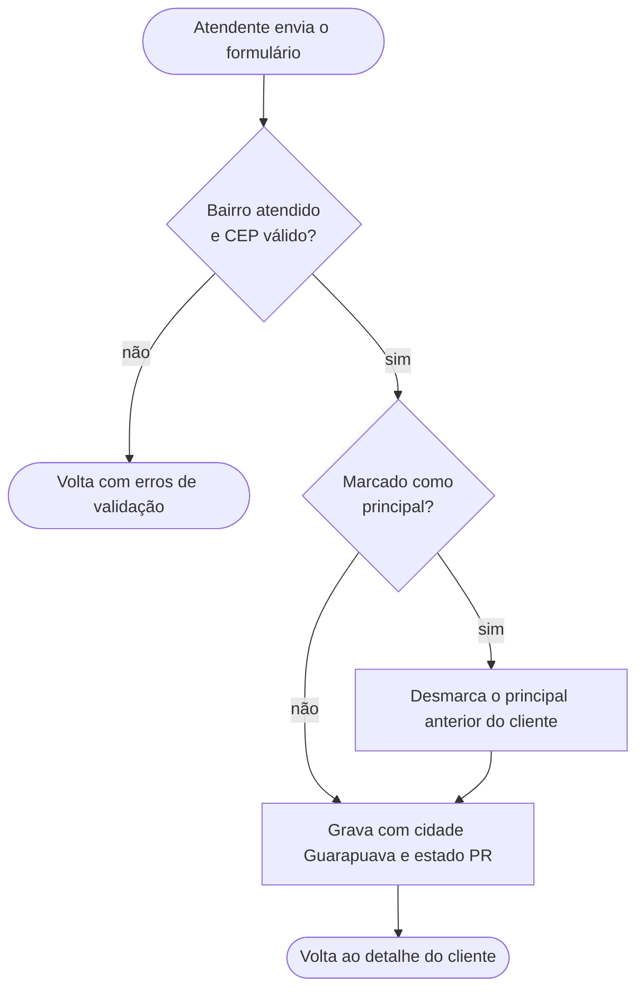

# 7. Fluxos e estados

## 7.1 Ciclo de vida do pedido

| Status | Itens podem mudar? | Aceita cupom? | Aceita pagamento? | Ações na tela |
|---|---|---|---|---|
| `RECEBIDO` | Sim (se ainda sem pagamento) | Sim | Sim | Aplicar cupom, registrar pagamento, cancelar |
| `EM_PREPARO` | Não (já pago) | Não | Não | Avançar status, cancelar |
| `PRONTO` | Não | Não | Não | Avançar status, cancelar |
| `SAIU_PARA_ENTREGA` | Não | Não | Não | Avançar status, cancelar |
| `ENTREGUE` | Não | Não | Não | Nenhuma |
| `CANCELADO` | Não | Não | Não | Nenhuma |

## 7.2 Ciclo de vida do pagamento

> A aplicação nunca cria pagamentos `PENDENTE`. Esse status existe por compatibilidade com o banco do 1º bimestre e é tratado por `sp_cancelar_pedido`.

## 7.3 Sequência: registrar pedido com cupom

## 7.4 Sequência: registrar pagamento

## 7.5 Sequência: cancelar pedido pago

## 7.6 Atividade: cadastro de endereço

Na edição, se o endereço já foi usado em algum pedido, qualquer mudança além de `e_principal` é recusada com "Endereço já usado em pedidos não pode ser alterado. Cadastre um novo."
