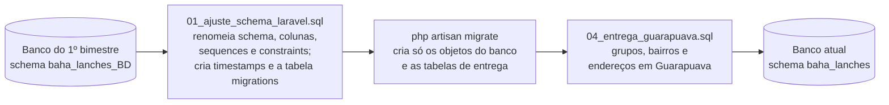

# 9. Operação do banco

## 9.1 Ambientes

| Ambiente | Onde | Observação |
|---|---|---|
| Principal | Neon, banco `baha_lanches_DB`, schema `baha_lanches` | Usar o **endpoint direto** (sem `-pooler` no host), como orienta o README do projeto. |
| Testes | Branch separada do Neon ou banco local | Configurado em `.env.testing`. **Nunca** apontar para o banco principal: a suíte recria todas as tabelas. |
| Local | PostgreSQL 18 (instalado ou em Docker) | Ver [Ambiente de desenvolvimento](11-ambiente-de-desenvolvimento.md). |

## 9.2 Scripts SQL

Ficam em `database/sql`. Em um banco novo, o caminho normal é `php artisan migrate` + `php artisan db:seed`; os scripts servem para manutenção, auditoria e para recriar o banco sem o Laravel.

| Script | Finalidade | Quando usar |
|---|---|---|
| `00_estrutura.sql` | Estrutura completa (tabelas, índices, functions, procedures e triggers), gerada com `pg_dump`. | Recriar o banco fora do Laravel. Rodar antes do `03`. |
| `01_ajuste_schema_laravel.sql` | Converte o banco legado do 1º bimestre para o padrão do Laravel. | Uma única vez, em banco com a estrutura antiga. |
| `02_objetos.sql` | Índices de regra, functions, procedures e triggers. | Executado automaticamente pelas migrations. |
| `03_dados.sql` | Carga de dados de demonstração. | Executado pelo `DatabaseSeeder`. |
| `04_entrega_guarapuava.sql` | Cria grupos e bairros de entrega e move os endereços legados para Guarapuava. | Uma única vez, após as migrations, em banco com os dados antigos. |
| `05_verificar_restauracao.sql` | Resumo de linhas, md5 do conteúdo e objetos do banco. | Comparar banco original e restaurado. |
| `06_explain_indices.sql` | Compara planos de execução com e sem índices, com dados reais e com volume simulado. | Avaliar índices. Rodar em banco restaurado. |
| `06_explain_consultas.sql` | Consultas analisadas pelo script anterior. | Incluído pelo `06_explain_indices.sql`. |

## 9.3 Migração do banco legado

O banco original usava o schema `baha_lanches_BD` e chaves no formato `id_cliente`. A conversão para o Laravel foi feita em etapas:



Pontos importantes da conversão:

- Views analíticas antigas (`vw_gabriel_*`) foram removidas.
- Chaves primárias passaram a se chamar `id` e estrangeiras `x_id`.
- `created_at` e `updated_at` foram preenchidos com a data real de cada registro quando ela existia (`data_pedido`, `data_cadastro` etc.).
- As 11 migrations de tabelas foram registradas como já executadas, para que o `migrate` crie apenas o que faltava.
- Os pedidos antigos mantêm a taxa e o total com que foram registrados.

## 9.4 Análise de desempenho dos índices

Executado com `06_explain_indices.sql` em banco restaurado, dentro de uma transação desfeita no final. Saída completa em [`evidencias/explain_indices.txt`](evidencias/explain_indices.txt).

Tempo de execução com volume simulado (+100 mil pedidos e +200 mil itens):

| Índice | Consulta | Sem índice | Com índice |
|---|---|---|---|
| `idx_pedidos_abertos_data` | 50 pedidos em aberto mais antigos | 10,013 ms | 0,104 ms |
| `idx_gabriel_data_pedido_pedidos` | Pedidos de uma semana | 5,098 ms | 0,217 ms |
| `idx_gabriel_id_cliente_pedidos` | Pedidos de um cliente | 5,240 ms | 0,730 ms |
| `idx_gabriel_id_pedido_itens_pedido` | Itens de um pedido | 8,869 ms | 0,057 ms |

Com o volume real (480 pedidos), a diferença é mínima e o PostgreSQL prefere leitura sequencial em algumas consultas, porque a tabela cabe em poucas páginas. Os índices se justificam pelo crescimento esperado.

> Atenção: o script executa `DROP INDEX`, que bloqueia as tabelas até o fim da transação. Nunca rode no banco principal.

## 9.5 Backup e restauração

Procedimento validado em 01/11/2026. Evidência em [`evidencias/backup_restauracao.txt`](evidencias/backup_restauracao.txt).

**Backup** (gera `database/backups/baha_lanches_AAAA-MM-DD.sql`):

```bash
pg_dump --no-owner --no-privileges --clean --if-exists --schema=baha_lanches \
  --file=database/backups/baha_lanches_2026-11-01.sql "$DATABASE_URL"
```

**Restauração** em um banco vazio:

```bash
psql "$DATABASE_URL_DESTINO" -c "CREATE DATABASE baha_lanches_restore"
psql "$DATABASE_URL_RESTORE" --set=ON_ERROR_STOP=1 --file=database/backups/baha_lanches_2026-11-01.sql
```

**Verificação:** rodar `05_verificar_restauracao.sql` nos dois bancos e comparar as saídas.

```bash
psql "$DATABASE_URL" --file=database/sql/05_verificar_restauracao.sql > original.txt
psql "$DATABASE_URL_RESTORE" --file=database/sql/05_verificar_restauracao.sql > restaurado.txt
diff original.txt restaurado.txt
```

O resultado validado teve saídas idênticas, inclusive o md5 do conteúdo de cada uma das 14 tabelas, e a restauração levou 41,6 segundos.

## 9.6 Rotina recomendada

| Quando | O quê |
|---|---|
| Antes de cada entrega ou mudança de estrutura | Backup com `pg_dump` e verificação com `05_verificar_restauracao.sql`. |
| Ao alterar `02_objetos.sql` | Nova migration que reexecuta o arquivo, atualização do `00_estrutura.sql` e testes em `tests/Feature/Banco`. |
| Ao criar um índice | Medir com `06_explain_indices.sql` e registrar a saída em `docs/evidencias`. |
